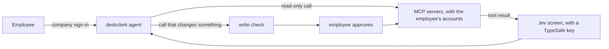

# deskclerk

[](https://github.com/jiacwng/deskclerk/actions/workflows/ci.yml)

deskclerk is an internal company agent. An admin lists the company's MCP servers. Employees
sign in with the company login, connect their own accounts on those servers and ask the agent
to work there. Before a call that changes something runs, deskclerk checks it against the
tool's schema, and a destructive call against the ids the agent has seen. Then the employee
approves or rejects it in the page. Each employee has a monthly budget, a request quota and their
own conversations, and every request goes to an audit log.



## Try it

You need Docker with Compose and an Anthropic API key. The steps run deskclerk, a development
Keycloak and a demo task server on this machine, on the ports 8000, 8080 and 8100. deskclerk and
the demo server share Keycloak's network. Docker Desktop for Mac is not tested.

1. Copy `.env.example` to `.env`. Fill in `ANTHROPIC_API_KEY`, and make `DESKCLERK_TOKEN_KEY` and
   `DESKCLERK_SESSION_KEY` with the two `python3` commands in the file. Without a TypeSafe key,
   also add `DESKCLERK_ALLOW_UNSCREENED=true`.
2. Copy `servers.example.toml` to `servers.toml`. It lists the demo task server, which keeps a
   task list in memory and needs no account.
3. Start everything. The first start builds the image and takes about a minute.

   ```
   docker compose up -d --wait
   ```

4. Open http://localhost:8000 and sign in as `analyst` with the password `deskclerk`. Ask
   "Create a task called Write the release notes", then "Mark it as doing", then "Delete it".
   Approve each change when the page asks.

## Your own servers

List your MCP servers in `servers.toml`, or in a `.json` file in the `mcpServers` format:

```toml
[[server]]
name = "linear"
url = "https://mcp.linear.app/mcp"
```

A server without sign-in takes `auth = "none"`. A server that needs a registered OAuth client
takes `client_id` and `client_secret_env`, the name of the variable in `.env` that holds the
secret. A server's `tools` lists the only tools the agent may use from it. deskclerk trusts the
read-only marks of the servers you list. It is tested against Linear's hosted MCP server:
sign-in, reads, writes and the injection screen.

A server can also take `headers`, where `${env:NAME}` is replaced by that environment variable.
It can take `client_cert` and `client_key` for mutual TLS; mount those files into the container.
It can take `plain_http = true` to allow an `http://` address, for a server on a private network.
A server name uses letters, digits, hyphens and single underscores.

Each tool is pinned when an employee first uses its server. A tool that changes, or appears
later, is withheld until the employee reconnects. A server that does not answer is skipped for
that request, and the agent says so. A tool whose full name is longer than 64 characters is not
offered, and the log names it.

## Model, screen and tracing

deskclerk runs on Anthropic, OpenAI, Azure OpenAI or Amazon Bedrock. Set `DESKCLERK_MODEL` to
`anthropic:`, `openai:`, `azure_openai:` or `bedrock_converse:` followed by the model, such as
`openai:gpt-5`, and the variables that provider reads; startup names the first one missing. In
Docker, put the AWS credentials for Bedrock in `.env`. A model the price list does not know, such
as an Azure deployment name, is priced as the model in `DESKCLERK_PRICE_MODEL`, such as
`azure_openai:gpt-5`.

With `TYPESAFE_API_KEY`, deskclerk sends every tool result and the employee's request to
TypeSafe's Jev model, and withholds a result Jev flags or cannot judge. Without the key,
deskclerk refuses to start unless `DESKCLERK_ALLOW_UNSCREENED=true` is set. With
`DESKCLERK_TOOL_SELECTION=true` and two or more servers, Jev also picks the servers a request
needs. With `LANGFUSE_PUBLIC_KEY` and `LANGFUSE_SECRET_KEY`, deskclerk traces each request to
Langfuse, with its text masked unless `DESKCLERK_AUDIT_TEXT` is set. The audit log is one JSON
line per request on standard output.

## Your company login

Set `DESKCLERK_ISSUER`, `DESKCLERK_CLIENT_ID` and `DESKCLERK_PUBLIC_URL` in `.env`, remove the
demo server from `servers.toml`, and start the app alone with
`docker compose up -d --no-deps deskclerk`. Register its `/login/callback` address with your
provider. If the provider gives the app a client secret, set `DESKCLERK_CLIENT_SECRET`.
deskclerk names each employee by the `sub` claim, which a provider never gives to another person.
Signing out ends the session on the server. Set the client's back-channel logout URL to
`https://<your deskclerk>/logout/backchannel`, so that disabling an employee at the provider also
signs them out of deskclerk.
On Entra ID, set `DESKCLERK_USER_CLAIM=oid`, the id that stays the same across all apps of the
tenant.

The employees' MCP tokens and conversations are stored in the `deskclerk-data` volume, encrypted
with `DESKCLERK_TOKEN_KEY`. deskclerk refuses to start with a different key, so keep it. Run one
deskclerk container on a local disk: the request quota, the spending check and pending sign-ins
live in its memory. The `DESKCLERK_` settings, such as `DESKCLERK_BUDGET_USD` (2 USD a month by
default), are listed in `src/deskclerk/config.py`.

`docker compose exec deskclerk python -m deskclerk erase <user_id>` deletes one employee's
tokens, conversations and spending, and writes one audit line with the counts.
`DESKCLERK_RETENTION_DAYS` deletes conversations unused for that many days. The default, 0,
keeps them.

## Serving it over HTTPS

deskclerk listens on 127.0.0.1:8000 by default, so put a reverse proxy on the same machine in
front of it, or set DESKCLERK_HOST=0.0.0.0 when the proxy runs in another container. With
Caddy, which gets a TLS certificate by itself, this Caddyfile is enough:

```
deskclerk.example.com {
    reverse_proxy 127.0.0.1:8000
}
```

Set `DESKCLERK_PUBLIC_URL` to `https://deskclerk.example.com` and register
`https://deskclerk.example.com/login/callback` with your identity provider. With an https public
URL, deskclerk marks its cookies Secure.

## Results

Claude Haiku 5.5 is the agent in every run. The commands to rerun each row are in
`bench/README.md`.

| What | Result | Limit |
|---|---|---|
| WorkBench, 459 held-out workplace tasks over five MCP servers, graded by WorkBench's own scorer | deskclerk: 441 correct, 7 harmful. WorkBench's own agent loop: 447 correct, 7 harmful. | No measurable difference (exact McNemar p = 0.18 correct, p = 1.0 harmful). One test run per loop, with deskclerk's write check off. The reference run is from an earlier date with the same model. It is near the ceiling at 447 of 459. |
| The same tasks and servers, with Jev picking the servers a task needs | 442 correct, 9 harmful, at 57% of the cost per task of offering every tool, Jev included. | No measurable difference from offering every tool (p = 1.00 correct, p = 0.69 harmful). The threshold was fitted on the 231 dev tasks. Single-turn tasks only. |
| AgentDojo v1.2.2, 949 attacked runs over four suites | Attack success with no defense: 2.0% (19 of 949), with 84.5% of tasks completed with no attack and 81.9% under attack. With spotlighting: 1.9%. With a DeBERTa screen: 0.0%, with 45.4% and 38.7% of tasks completed. With Prompt Guard 2 as the screen: 0.4% (4 of 949), with 84.5% and 67.7%. With Jev as the screen: 0.0%, with 84.5% and 20.7%. | One agent model, one attack, one run per task. The baseline has 19 successes. Jev's question was rewritten once after a first run that completed 82.5% and 21.0%. |
| Three injection screens on 1,786 distinct tool outputs that the undefended agent read in AgentDojo | Outputs with the attack's marker flagged (1,174): Jev 100.0%, Prompt Guard 2 31.7%, DeBERTa 64.3%. Outputs without it flagged (612): Jev 0.0%, Prompt Guard 2 0.0%, DeBERTa 30.6%. | One attack with a fixed text, labelled by its marker. Outputs repeat across runs. |
| LLMail-Inject: 5,000 of the 37,303 prompt injections people wrote in Microsoft's phase 2 challenge, against 160 of the challenge's clean emails | Injections flagged: Jev 75.2%, Prompt Guard 2 16.1%, DeBERTa 34.1%. Clean emails flagged: none by any screen. ROC AUC: 0.995, 0.986, 0.986. With the 612 clean AgentDojo outputs added, DeBERTa flags 187 of them and the AUC is 0.990, 0.805, 0.631. | Every submission counts as an injection, including broken ones. One request for every email. Submissions from one team are alike, so the intervals in the report are too narrow. None of 160 clean emails flagged still allows a rate up to about 2.3%. |
| InjecAgent, 2,108 cases in its base and enhanced settings | With no defense, 0 attacks succeed and 171 outputs are invalid, so the screen has nothing to stop. Jev flagged 88.2% of the injected tool results, and invalid outputs rose to 404, mostly the agent calling the user tool again. | One model, one run. None of 2,108 still allows a rate up to about 0.14%. The cases are templated and single-step. The runner calls the model through Anthropic's Messages API. |
| TypeSafe's Jev scoring 1,742 write calls from the WorkBench runs | ROC AUC 0.47 on test and 0.55 on dev | An AUC of 0.5 is chance. Haiku 5.5 as the judge scored 0.63 on test. |

## License

Apache 2.0. See `LICENSE`.
