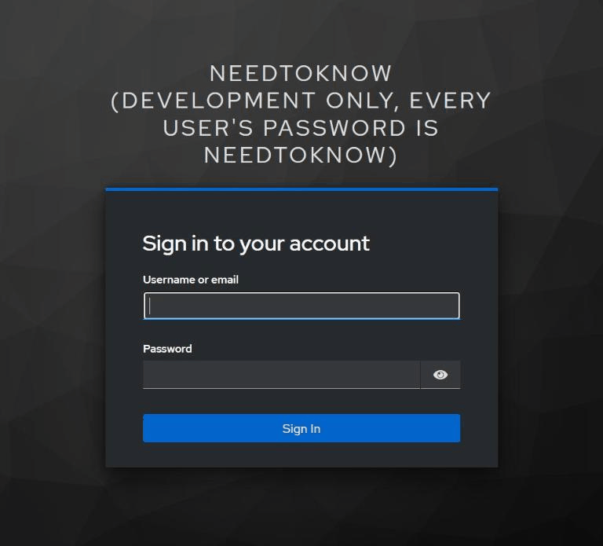

# needtoknow

needtoknow is a company AI assistant that answers questions from company documents and data. It never uses a document the person asking cannot open, because PostgreSQL row-level security filters every read.

[](https://github.com/jiacwng/needtoknow/actions/workflows/ci.yml)



## Results

All runs use claude-haiku-5-5. Each count has its 95% Wilson interval in the linked table.

| What | Result | Limit |
|---|---|---|
| [Leaks on Enron](results/leaks_enron.md): 200 emails asked by a custodian who may not read them | Row-level security: 0 of 200 answers contain the email. The same filter written in the query and then removed: 23 of 200. | Counts a distinctive token, so a paraphrased leak is missed. |
| [Access without a model](results/access.md): every email opened by a custodian who does not hold it | 0 of 254,544 opened | Checks the enforcement, not who should hold each email. |
| [Answers on EnronQA](results/answers_enron.md): 200 questions asked by the email's custodian | 124 of 200 correct | Judged by TypeSafe's Jev; its agreement with people on this task is not measured. |
| [Injection screen](results/attacks.md) on BIPIA's train split, unseen while tuning | 261 of 296 attacks caught, 0 of 548 clean passages flagged | The screened rows in the table use the split the screen was tuned on. |
| [Database attacks](results/attacks.md) from published SQL injection and session attacks | 4 of 4 blocked | Four attacks. |
| [BIRD Mini-Dev](results/bird.md) text to SQL, 498 questions | Agent 282, single prompt baseline 296 | McNemar p = 0.125. The agent costs 3.5 times as much. |

## Try it

The demo uses Enron's emails. Enron was a US energy company, and its email became a public dataset after its 2001 collapse. The demo loads 50 of those emails and three employees. Each email can only be read by the employees whose mailbox held it, so the same question gets a different answer depending on who asks.

```
git clone https://github.com/jiacwng/needtoknow
cd needtoknow
echo ANTHROPIC_API_KEY=your-key > .env
docker compose up -d --wait
```

On Windows, run these in Git Bash or WSL. Open http://localhost:8000 and sign in as one of them, all with the password `needtoknow`:

- `kaminski-v`: Vince Kaminski, head of research
- `dasovich-j`: Jeff Dasovich, senior director for California's energy crisis
- `kean-s`: Steven Kean, executive vice president and chief of staff

Questions to try. Sign out and sign in as someone else to compare.

| Question | Who gets the answer |
|---|---|
| Who in Vince Kaminski's group helps with the Wharton and Rice projects? | Only `kaminski-v` |
| What is the proposal to extend the rate freeze, and which bill was it first attached to? | Only `dasovich-j` |
| Why was the signing of phase II of the Lagos State project delayed? | Only `kean-s` |
| Which firm ran Enron's polling in California? | `dasovich-j` and `kean-s`, because the email reached both. `kaminski-v` gets nothing. |

## Connect an MCP client

The MCP server at `http://127.0.0.1:8001/mcp` offers `search_documents`, `describe_data` and `query_data`. The client registers itself and signs you in through the browser. This works for clients with a localhost callback, such as Claude Code and VS Code.

```
claude mcp add --transport http needtoknow http://127.0.0.1:8001/mcp
```

## Use it with your company

`compose.prod.yaml` runs everything on one server behind Caddy, which gets a TLS certificate for your domain. Copy `.env.example` to `.env`, fill in its production half and set `NEEDTOKNOW_DOMAIN`. The stack refuses to start without every password.

```
mkdir documents
docker compose -f compose.prod.yaml up -d --wait
```

Add your employees and groups. Keycloak ships with the stack, and its admin console listens on the server's port 8080 only, so reach it through a tunnel:

```
ssh -L 8080:127.0.0.1:8080 you@your-server
```

Open http://localhost:8080/auth, sign in with the admin from `.env` and pick the `needtoknow` realm. Create a group, then a user with a password, and add the user to the group. To use your own login instead, point `NEEDTOKNOW_ISSUER` at any OpenID Connect provider and set the claims below.

Put your files in `documents/files/`: PDF, Word, PowerPoint, Excel, HTML, Markdown or text. Say who may read them in `documents/access.jsonl`. The last matching line wins, and a file no line matches stops the load.

```
{"path": "*", "public": true}
{"path": "finance/*", "groups": ["finance"]}
```

Load them, and run the same command again after files change. Files removed from the folder are removed from search.

```
docker compose -f compose.prod.yaml run --rm load files /data/files --access /data/access.jsonl --delete-missing
```

Connect your own PostgreSQL database to the SQL tools. Set `NEEDTOKNOW_DATA_HOST`, `NEEDTOKNOW_DATA_NAME` and `NEEDTOKNOW_DATA_PASSWORD` in `.env`. A superuser of that database runs the setup once:

```
docker compose -f compose.prod.yaml run --rm -e NEEDTOKNOW_ADMIN_USER=postgres -e NEEDTOKNOW_ADMIN_PASSWORD=yourpassword load data-setup
```

The setup creates the role `needtoknow_app` and the function that tells the database who is asking. It takes away the built-in functions that would let that role change who is asking or watch other sessions. Your existing roles keep them. Run it again after you add a role.

Then grant `needtoknow_app` the tables employees may query, with a policy on each. The setting `app.principals` holds the employee as `user:name` and each of their groups as `group:name`, separated by commas.

```
ALTER TABLE sales ENABLE ROW LEVEL SECURITY;
CREATE POLICY sales_read ON sales FOR SELECT TO needtoknow_app
USING (team = ANY (string_to_array(current_setting('app.principals', true), ',')));
GRANT SELECT ON sales TO needtoknow_app;
```

The app and the MCP server refuse to start while that role can read a table without row-level security.

## Settings

| Variable | Default | What it sets |
|---|---|---|
| `NEEDTOKNOW_MODEL` | `anthropic:claude-haiku-5-5` | Chat model as provider:model |
| `NEEDTOKNOW_BUDGET_USD` | `2.0` | Spending cap per process |
| `NEEDTOKNOW_ISSUER` | local Keycloak realm | OpenID Connect issuer |
| `NEEDTOKNOW_USER_CLAIM` | `preferred_username` | Claim naming the employee (`oid` on Entra ID, `sub` on Okta) |
| `NEEDTOKNOW_GROUPS_CLAIM` | `groups` | Claim listing the employee's groups |

Every other setting is listed with its default in `.env.example`.

## How it works

Each request carries an OpenID Connect access token, and the app reads the employee and their groups from it. A LangGraph agent searches documents with pgvector, opens them and runs read-only SQL inside a transaction as that employee. Row-level security decides every row it gets back. An optional injection screen withholds any passage that carries planted instructions before the model reads it. The app refuses to start while its database role can read a table without a policy.

## Evaluation

Each table in `results/` comes from a module in `src/needtoknow/evaluation/`, and the module's header gives the command that reruns it.

## License

Code under [LICENSE](LICENSE). Data extracts in `tests/data` keep their own licences, listed in [NOTICE](NOTICE).
