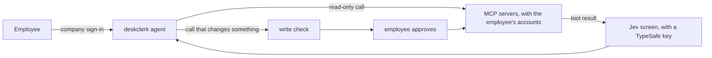

# deskclerk

[](https://github.com/jiacwng/deskclerk/actions/workflows/ci.yml)

deskclerk is an agent that works in a company's tools for its employees. An admin lists the
company's MCP servers. Employees sign in with the company login, connect their own accounts and
ask in plain words. A call that changes data waits until the employee approves it in the page.
Tool results are screened for prompt injection, and every request goes to an audit log.



## Try it

You need Docker with Compose and an Anthropic API key. This runs deskclerk, a development
Keycloak and a demo task server on ports 8000, 8080 and 8100.

1. Copy `.env.example` to `.env`. Fill in `ANTHROPIC_API_KEY`, and make `DESKCLERK_TOKEN_KEY` and
   `DESKCLERK_SESSION_KEY` with the two `python3` commands in the file. Without a TypeSafe key,
   also set `DESKCLERK_ALLOW_UNSCREENED=true`.
2. Copy `servers.example.toml` to `servers.toml`. It lists the demo task server, which needs no
   account.
3. Start everything. The first start builds the image and takes about a minute.

   ```
   docker compose up -d --wait
   ```

4. Open http://localhost:8000 and sign in as `analyst` with the password `deskclerk`. Ask
   "Create a task called Write the release notes", then "Mark it as doing", then "Delete it".
   Approve each change when the page asks.

## Run it at your company

1. In `.env`, set `DESKCLERK_ISSUER`, `DESKCLERK_CLIENT_ID` and `DESKCLERK_PUBLIC_URL` for your
   login server, and register `https://<your deskclerk>/login/callback` with it.
2. List your MCP servers in `servers.toml`. `servers.example.toml` describes each option.
3. Start deskclerk alone with `docker compose up -d --no-deps deskclerk`, behind a reverse proxy
   that serves HTTPS. With Caddy this is enough:

   ```
   deskclerk.example.com {
       reverse_proxy 127.0.0.1:8000
   }
   ```

`.env.example` describes every other setting: the model provider, the screen, budgets, retention
and tracing. Keep `DESKCLERK_TOKEN_KEY`, because the stored tokens and conversations are encrypted
with it. Run one container, because quotas and pending sign-ins live in its memory. With a
TypeSafe key, each request and every tool result are also sent to TypeSafe's API to be screened.
`docker compose exec deskclerk python -m deskclerk erase <user_id>` deletes one employee's data.

## Results

Claude Haiku 5.5 is the agent in every run.

- On 459 WorkBench workplace tasks, deskclerk gets 441 right and WorkBench's own agent gets 447
  (p = 0.18).
- On 949 AgentDojo prompt injection attacks, 2.0% succeed with no defense. With the Jev screen,
  1.9% succeed when the employee approves every call, and none when they reject the calls after
  a flag.
- On 5,000 LLMail-Inject attacks, Jev flags 75.2%, and none of 160 clean emails.

`bench/README.md` has every result with its limits, and the commands to rerun it.

## License

Apache 2.0. See `LICENSE`.
