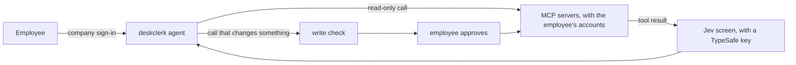

# deskclerk

[](https://github.com/jiacwng/deskclerk/actions/workflows/ci.yml)

deskclerk is an agent that works in a company's tools for its employees. An admin lists the
company's MCP servers. Employees sign in with the company login, connect their own accounts and
ask in plain words. A call that changes data waits until the employee approves it in the page.
Before a tool result reaches the model, it is screened for prompt injection: text in an email,
page or ticket that tries to make the agent do something the employee did not ask for. The screen
is Jev, a hosted model from TypeSafe that answers yes or no questions about text. Every request
goes to an audit log.



## Try it

You need Docker with Compose and an API key for one model provider: Anthropic, OpenAI, Azure
OpenAI or AWS Bedrock. This runs deskclerk, a development Keycloak and a demo task server on ports
8000, 8080 and 8100.

1. Copy `.env.example` to `.env`. Fill in `ANTHROPIC_API_KEY`, or set `DESKCLERK_MODEL` and your
   provider's key as `.env.example` shows. Make `DESKCLERK_TOKEN_KEY` and
   `DESKCLERK_SESSION_KEY` with the two `python3` commands in the file. Without a TypeSafe key,
   also set `DESKCLERK_ALLOW_UNSCREENED=true`.
2. Copy `servers.example.toml` to `servers.toml`. It lists the demo task server, a small to-do
   list that stands in for a tracker like Linear or Jira and needs no account. The same file shows
   how to add Linear's hosted MCP server, which deskclerk was tested on.
3. Start everything. The first start builds the image and takes about a minute.

   ```
   docker compose up -d --wait
   ```

4. Open http://localhost:8000 and sign in as `analyst` with the password `deskclerk`. Ask
   "Create a task called Write the release notes", then "Mark it as doing", then "Delete it".
   Approve each change when the page asks.

## Run it at your company

1. In `.env`, set `DESKCLERK_ISSUER`, `DESKCLERK_CLIENT_ID` and `DESKCLERK_PUBLIC_URL` for your
   login server, and register `https://<your deskclerk>/login/callback` with it. Set
   `DESKCLERK_CLIENT_SECRET` too when the login server gives the app a secret, as Entra ID and Okta
   web apps do. The issuer is `https://login.microsoftonline.com/<tenant>/v2.0` on Entra ID and
   `https://<org>.okta.com/oauth2/default` on Okta.
2. List your MCP servers in `servers.toml`. `servers.example.toml` describes each option.
   When you register an OAuth app for a server, its callback is
   `https://<your deskclerk>/oauth/callback`.
3. Start deskclerk with `docker compose -f compose.prod.yaml up -d`, behind a reverse proxy
   that serves HTTPS. With Caddy this is enough:

   ```
   deskclerk.example.com {
       reverse_proxy 127.0.0.1:8000
   }
   ```

`.env.example` describes every other setting: the model provider, the screen, budgets, retention
and tracing. Keep `DESKCLERK_TOKEN_KEY`, because the stored tokens and conversations are encrypted
with it. With a TypeSafe key, each request and every tool result are also sent to TypeSafe's API
to be screened.

All state lives in one Postgres database. `compose.prod.yaml` starts it and sets
`DESKCLERK_DATABASE_URL` from `POSTGRES_PASSWORD`, which you set in `.env` with letters and digits
only. To use your own Postgres, set `DESKCLERK_DATABASE_URL` instead. Several copies of deskclerk
can run behind a load balancer on one database, and each copy opens up to 41 connections.

## Operate it

- `docker compose -f compose.prod.yaml exec deskclerk python -m deskclerk usage` prints what each
  employee spent this month.
- `... python -m deskclerk erase <user_id>` deletes one employee's data. The user id is the
  `DESKCLERK_USER_CLAIM` value, the object ID on Entra ID. With SCIM, the login server does this
  when it removes the employee.
- To back up, run
  `docker compose -f compose.prod.yaml exec postgres pg_dump -U deskclerk deskclerk > backup.sql`.
  Keep the token key with it.
- To upgrade, run `git pull`, then `docker compose -f compose.prod.yaml up -d --build`.
- `/livez` answers while the process runs, and `/readyz` once it can serve.
- Sign-in and connection failures are logged with their reason. The audit log is one JSON line per
  request on standard output.

## Results

Claude Haiku 5.5 is the agent in every run.

- On 459 WorkBench workplace tasks, deskclerk gets 441 right and WorkBench's own agent gets 447
  (p = 0.18).
- On 949 AgentDojo prompt injection attacks, 2.0% succeed with no defense. With the Jev screen,
  1.9% succeed when the employee approves every call, and none when they reject the calls after
  a flag.
- On 5,000 LLMail-Inject attacks, Jev flags 75.2%, and none of 160 clean emails.

`bench/README.md` has every result with its limits, and the commands to rerun it.

## License

Apache 2.0. See `LICENSE`.
