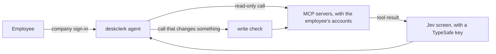

# deskclerk

[](https://github.com/jiacwng/deskclerk/actions/workflows/ci.yml)

deskclerk is an internal company agent. An admin lists the company's MCP servers. Employees
sign in with the company login, connect their own accounts on those servers and ask the agent
to work there. Before a call that changes something runs, deskclerk checks it against the
tool's schema, as the server declares it, and a destructive call against the ids the agent has
seen. Each employee has a budget and a request quota, and every request goes to an audit log.



## Setup

You need Docker with Compose and an Anthropic API key. The steps below run deskclerk and a
development Keycloak on this machine. The app uses the host's network, which Docker Engine on
Linux and WSL supports.

1. Copy `.env.example` to `.env` and fill in `ANTHROPIC_API_KEY`, `DESKCLERK_TOKEN_KEY` and
   `DESKCLERK_SESSION_KEY`. The file shows how to make each key. With `TYPESAFE_API_KEY`,
   deskclerk sends every tool result and the employee's request to TypeSafe's Jev model, and
   withholds a result Jev flags or cannot judge. With `LANGFUSE_PUBLIC_KEY` and
   `LANGFUSE_SECRET_KEY`, deskclerk traces each request to Langfuse, with its text masked unless
   `DESKCLERK_AUDIT_TEXT` is set.
2. List the MCP servers in `servers.toml`:

   ```toml
   [[server]]
   name = "calendar"
   url = "https://mcp.example.com/calendar"
   ```

   A server without sign-in takes `auth = "none"`. A server that needs a registered OAuth
   client takes `client_id` and `client_secret_env`, the name of the variable in `.env` that
   holds the secret. deskclerk trusts the read-only marks of the servers you list.
3. Start both services:

   ```
   docker compose up -d --wait
   ```

4. Open http://localhost:8000 and sign in as `analyst` with the password `deskclerk`.

The employees' MCP tokens are stored in the `deskclerk-data` volume, encrypted with
`DESKCLERK_TOKEN_KEY`. deskclerk refuses to start with a different key, so keep it.

For your company login, set `DESKCLERK_ISSUER`, `DESKCLERK_CLIENT_ID` and
`DESKCLERK_SIGN_IN_REDIRECT_URL` in `.env` and start the app alone with
`docker compose up -d --no-deps deskclerk`. The `DESKCLERK_` settings are listed in
`src/deskclerk/config.py`.

## Serving it over HTTPS

deskclerk listens on 127.0.0.1:8000 by default, so put a reverse proxy on the same machine in
front of it, or set DESKCLERK_HOST=0.0.0.0 when the proxy runs in another container. With
Caddy, which gets a TLS certificate by itself, this Caddyfile is enough:

```
deskclerk.example.com {
    reverse_proxy 127.0.0.1:8000
}
```

Set `DESKCLERK_SIGN_IN_REDIRECT_URL` to `https://deskclerk.example.com/login/callback` and
`DESKCLERK_REDIRECT_URL` to `https://deskclerk.example.com/oauth/callback`, and register the
sign-in URL with your identity provider. With an https sign-in URL, deskclerk marks its cookies
Secure.

## Results

Claude Haiku 5.5 is the agent in every run. The commands to rerun each row are in
`bench/README.md`.

| What | Result | Limit |
|---|---|---|
| WorkBench, 459 held-out workplace tasks, graded by WorkBench's own scorer | deskclerk: 443 correct, 9 harmful. WorkBench's own agent loop: 447 correct, 7 harmful. | No measurable difference (exact McNemar p = 0.39 correct, p = 0.73 harmful). One test run per loop. The reference is near the ceiling at 447 of 459. |
| AgentDojo v1.2.2, 949 attacked runs over four suites | Attack success with no defense: 2.0% (19 of 949), with 84.5% of tasks completed with no attack and 81.9% under attack. With spotlighting: 1.9%. With a DeBERTa screen: 0.0%, with 45.4% and 38.7% of tasks completed. With Prompt Guard 2 as the screen: 0.4% (4 of 949), with 84.5% and 67.7%. With Jev as the screen: 0.0%, with 84.5% and 20.7%. | One agent model, one attack, one run per task. The baseline has 19 successes. Jev's question was rewritten once after a first run that completed 82.5% and 21.0%. |
| Three injection screens on 1,975 distinct tool outputs that the undefended agent read in AgentDojo | Outputs with the attack's marker flagged (1,174): Jev 100.0%, Prompt Guard 2 31.7%, DeBERTa 64.3%. Outputs without it flagged (801): Jev 0.0%, Prompt Guard 2 0.0%, DeBERTa 30.3%. | One attack with a fixed text, labelled by its marker. Outputs repeat across runs. |
| TypeSafe's Jev scoring 1,742 write calls from the WorkBench runs | ROC AUC 0.47 on test and 0.55 on dev | An AUC of 0.5 is chance. Haiku 5.5 as the judge scored 0.63 on test. |

## License

Apache 2.0. See `LICENSE`.
